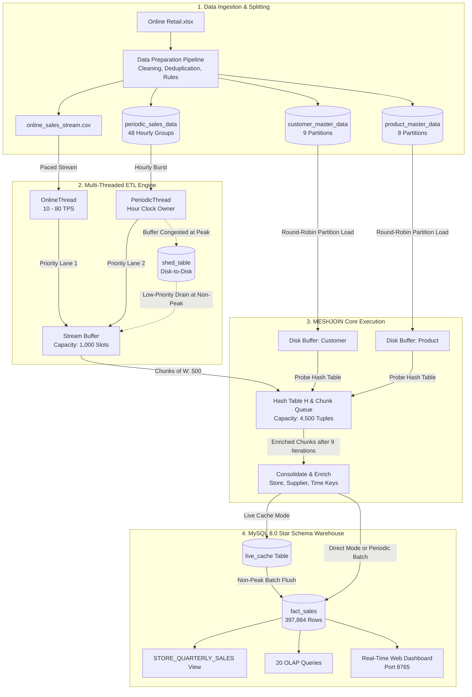
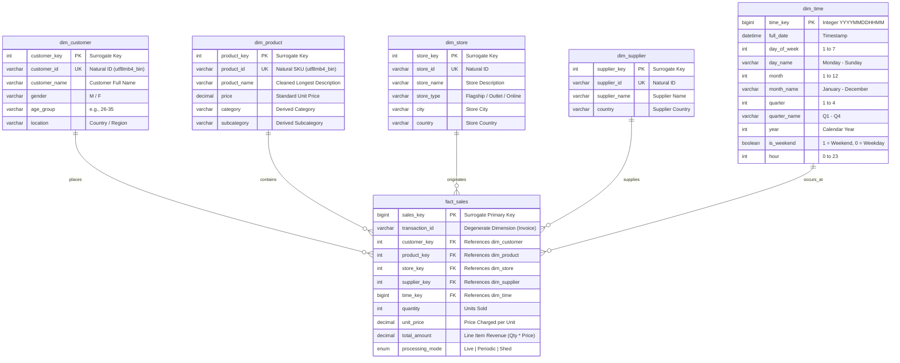

# Retail Data Warehouse & Stream-Relation MESHJOIN ETL Engine

[](https://www.python.org/)
[](https://www.mysql.com/)
[](https://www.docker.com/)
[](ReadMe/TESTING.md)
[](Create-DW/create_dw.sql)
[](LICENSE)

> A high-throughput, fault-tolerant retail Data Warehouse in MySQL 8.0 powered by a multi-threaded Python ETL engine. Features a bounded-memory implementation of the **MESHJOIN (Mesh Join)** stream-relation equijoin algorithm, dual-stream ingestion (continuous online streaming + periodic batch store arrivals), adaptive dynamic load shedding, crash-resilient state recovery, a real-time web telemetry dashboard, and 20 OLAP analytical queries.

---

## Table of Contents

- [Overview](#overview)
- [Key Architectural Highlights](#key-architectural-highlights)
- [System Architecture](#system-architecture)
- [Dimensional Model (Star Schema)](#dimensional-model-star-schema)
- [Technology Stack](#technology-stack)
- [Project Layout](#project-layout)
- [Prerequisites & System Requirements](#prerequisites--system-requirements)
- [Installation & Quick Start](#installation--quick-start)
  - [1. Clone & Set Up Environment](#1-clone--set-up-environment)
  - [2. Database Provisioning](#2-database-provisioning)
  - [3. Dataset Preparation](#3-dataset-preparation)
  - [4. Running the Engine](#4-running-the-engine)
- [CLI Configuration & Options](#cli-configuration--options)
- [Interactive Console Controls](#interactive-console-controls)
- [Real-Time Monitoring Dashboard](#real-time-monitoring-dashboard)
- [OLAP Business Intelligence Queries](#olap-business-intelligence-queries)
- [Fault Tolerance & Crash Recovery](#fault-tolerance--crash-recovery)
- [Verification & Quality Assurance](#verification--quality-assurance)
  - [Test Suite Breakdown](#test-suite-breakdown)
  - [Reference Run Benchmarks](#reference-run-benchmarks)
- [Design Decisions & Specifications](#design-decisions--specifications)
- [Dataset Citation](#dataset-citation)
- [Author & Contact](#author--contact)
- [License](#license)

---

## Overview

Modern retail enterprises face a dual-ingestion challenge: transactions arrive both as continuous, high-velocity clickstream purchases (**online sales**) and as delayed, hourly batch rollups (**in-store sales**). Enriching these streams against master datasets (such as customers and products) typically strains transactional databases or exhausts memory if entire lookup tables are loaded into RAM.

This project delivers a production-grade solution by combining:
1. **The MESHJOIN Algorithm:** An efficient, memory-bounded stream-relation equijoin algorithm designed to join continuous transaction streams with large, disk-resident relation tables without scanning the entire table for each transaction.
2. **Dual Cadence Ingestion:** Near-real-time streaming (10–80+ transactions/sec) interleaved with 48 periodic store batch groups (~119k transactions).
3. **Adaptive Load Shedding:** Automated, disk-to-disk offloading during peak burst congestion, paired with priority drain-back during non-peak cycles.
4. **Star Schema DWH:** A clean dimensional model hosted on MySQL 8.0 with binary collation (`utf8mb4_bin`) to ensure strict alphanumeric SKU integrity.
5. **Business Intelligence Suite:** 20 analytical SQL queries and an automated quarterly reporting view (`STORE_QUARTERLY_SALES`) answering critical executive retail questions.

---

## Key Architectural Highlights

* **Bounded Memory Footprint:** Regardless of transaction volume, memory usage remains strictly bounded:
  * Stream buffer capacity: $1,000$ transactions.
  * In-memory hash table ($H$): $4,500$ transaction slots ($9$ chunks $\times 500$ slots).
  * Disk buffers: $500$ tuples per master data partition.
  * No Python dictionaries of master data exist in memory; tuples are probed directly from partition buffers into $H$.
* **Multi-Relation Simultaneous Equijoin:** The engine joins transactions with two separate master relations in the same lifecycle—Customer Master Data ($9$ partitions, $4,338$ tuples) and Product Master Data ($8$ partitions, $3,665$ tuples).
* **Asynchronous Live Cache Pipeline:** Online transactions can enter an asynchronous `live_cache` staging sink before being flushed into `fact_sales` during non-peak intervals, isolating stream throughput from index write contention.
* **Single-Writer Loading Guarantees:** All dimension surrogate keys and fact insertions are managed exclusively by the join thread, eliminating race conditions and deadlocks without distributed locks.
* **Atomic Resumption (`--resume`):** Transaction sequence numbers (`txn_seq`) and exact stream file offsets (`online_rows_committed`) are tracked atomically in database commit blocks. If killed mid-flight, the system resumes with zero duplicate and zero lost records.

---

## System Architecture

The pipeline orchestrates three asynchronous worker threads communicating through thread-safe bounded buffers, coordinated by a central console and runtime controller.



### Thread Responsibilities

| Thread | Role | Database Access | Concurrency Primitives |
|---|---|---|---|
| **`OnlineThread`** | Lazily streams online records with nanosecond-precision token-bucket pacing. | None (File I/O only) | `StreamBuffer` lock |
| **`PeriodicThread`** | Controls the simulated hour clock; admits batch group rows into the stream buffer. | Read-only (`periodic_sales_data`) | `StagingGate` mutex, `StreamBuffer` lock |
| **`MeshJoinThread`** | Executes the 4-step MESHJOIN loop, partition fetching, load shedding, and star schema persistence. | Dedicated write session | Single writer on warehouse tables |
| **`MainThread`** | Manages interactive CLI commands, periodic telemetry rendering, graceful shutdown, and audit reconciliation. | Audit read session | `RuntimeControl` atomic state |

---

## Dimensional Model (Star Schema)

The analytical data warehouse follows Ralph Kimball's dimensional modeling methodology. The schema consists of a central fact table surrounded by five independent dimension tables, forming a true Star Schema (no snowflake dependencies).



### Key Dimensional Design Decisions
* **Fact Grain:** One line item per transaction basket (`(transaction_id, product_id)` is preserved with a surrogate `sales_key` since identical SKU line items can repeat within a cart).
* **Degenerate Dimension:** `transaction_id` is maintained directly on `fact_sales` to support cross-basket market analysis without an intermediate order dimension.
* **Direct Supplier Link:** Supplier connects directly to `fact_sales`, preventing normalization into a snowflake schema and allowing single-hop joins for supplier analytics.
* **Smart Time Key:** `time_key` is encoded as a `BIGINT` formatted as `YYYYMMDDHHMM`, allowing instantaneous time dimension resolution without index lookups.
* **Binary Collation (`utf8mb4_bin`):** All natural identifier columns use binary collation, preventing casing collisions on alphanumeric product codes (e.g., distinguishing `85123A` from `85123a`).

---

## Technology Stack

| Layer | Component | Technologies |
|---|---|---|
| **Core Engine** | Language & Runtime | **Python 3.12** (Standard Library threading, queues, dataclasses) |
| **Data Warehouse** | Relational OLAP Store | **MySQL 8.0+** (InnoDB, `utf8mb4_bin`, Views, Foreign Keys) |
| **Data Processing** | Ingestion & ETL | **Pandas 3.1.0**, **OpenPyXL 3.1.5**, **NumPy 2.5.4** |
| **Containerization** | Infrastructure & Throwaway DB | **Docker**, **Docker Compose** |
| **Telemetry & UI** | Real-Time Dashboard | **Python HTTP Server**, **Vanilla ES6 JavaScript**, **CSS3** |
| **Testing & QA** | Verification Harness | **Pytest 9.2.0**, **Independent Pandas Oracle**, Subprocess E2E |

---

## Project Layout

```text
.
├── Create-DW/
│   └── create_dw.sql                 # DDL: Star schema, dimensions, fact, views & working tables
├── Data/
│   ├── DATA_NOTE.md                  # Dataset lineage, preparation statistics, and dictionary
│   ├── customer_master_data.csv      # Partitioned customer master dataset (4,338 records)
│   ├── product_master_data.csv       # Partitioned product master dataset (3,665 records)
│   ├── online_sales_stream.csv       # Streaming online sales dataset (278,740 transactions)
│   └── raw/                          # Raw input folder for 'Online Retail.xlsx' (auto-downloaded)
├── Mesh-Join/
│   ├── docker-compose.yml            # Throwaway MySQL 8.0 test container (port 3307)
│   ├── requirements.txt              # Production runtime dependencies
│   ├── requirements-dev.txt          # Test and development dependencies
│   ├── pytest.ini                    # Pytest configuration and markers
│   ├── main.py                       # Application CLI entry point
│   ├── retail_dw/
│   │   ├── app.py                    # Application lifecycle, startup coordination, and shutdown
│   │   ├── config.py                 # CLI parsing, constants, and settings validation
│   │   ├── console.py                # Interactive command console & banner rendering
│   │   ├── control.py                # Thread-safe atomic runtime control state
│   │   ├── db.py                     # Connection pooling, reconnect logic, and transaction runners
│   │   ├── metrics.py                # Telemetry counters & hourly rolling metrics
│   │   ├── reconcile.py              # Exact row accounting and verification engine
│   │   ├── dashboard/                # Real-time web monitoring server & frontend
│   │   ├── load/                     # Star schema batch loaders, live cache sinks, consolidator
│   │   ├── meshjoin/                 # Core MESHJOIN algorithm, stream/disk buffers, hash tables
│   │   ├── prepare/                  # Data cleaning, MD5 rule derivation, master data split
│   │   └── threads/                  # Worker threads: OnlineThread, PeriodicThread, MeshJoinThread
│   ├── tests/
│   │   ├── unit/                     # 762 unit tests (pure algorithms, buffers, rules)
│   │   ├── integration/              # 363 integration tests (MySQL schemas, loaders, sinks)
│   │   ├── oracle/                   # 114 oracle tests (SQL queries verified vs Pandas oracle)
│   │   └── e2e/                      # 17 end-to-end and process crash recovery tests
│   └── tools/                        # Test result collectors and submission packagers
├── Project-Report/
│   ├── Project_Report.pdf            # Formal technical project report
│   └── evidence/                     # Empirical benchmark data (JSON timing logs, query outputs)
├── Queries-DW/
│   └── queries_dw.sql                # 20 business intelligence OLAP analytics queries
└── ReadMe/
    ├── ARCHITECTURE.md               # In-depth architectural mechanics and concurrency model
    └── TESTING.md                    # Detailed testing guide and failure injection scenarios
```

---

## Prerequisites & System Requirements

* **Python:** Version `3.12` or later.
* **MySQL Server:** Version `8.0` or later (Native installation or Docker).
* **Hardware:**
  * RAM: Minimum 1 GB free (Data preparation peaks at ~490 MB).
  * Storage: Minimum 1 GB free disk space.
* **Operating Systems:** Windows 10/11, macOS, or Linux.

---

## Installation & Quick Start

### 1. Clone & Set Up Environment

```bash
git clone https://github.com/Shahoud867/retail-meshjoin-dwh.git
cd retail-meshjoin-dwh

# Create and activate Python virtual environment
python -m venv .venv

# On Windows (PowerShell):
.venv\Scripts\Activate.ps1

# On Linux / macOS:
source .venv/bin/activate

# Install runtime dependencies
pip install -r Mesh-Join/requirements.txt
```

### 2. Database Provisioning

Choose **Option A** (existing local MySQL) or **Option B** (isolated Docker container):

#### Option A: Local MySQL Server
Ensure your local MySQL service is active. On Windows PowerShell:
```powershell
Start-Service MySQL80
```
> **Note:** You do not need to create tables or schemas manually. The Python application automatically creates the target database if missing and initializes `Create-DW/create_dw.sql`.

#### Option B: Throwaway Docker MySQL (Recommended for Testing)
An isolated MySQL container configured for port `3307`:
```bash
cd Mesh-Join
cp .env.example .env     # Update MYSQL_ROOT_PASSWORD if desired
docker compose up -d --wait
cd ..
```

### 3. Dataset Preparation
The system operates on the standard UCI Machine Learning Online Retail dataset:
* Place `Online Retail.xlsx` into `Data/raw/Online Retail.xlsx`.
* If absent at startup, the interactive CLI prompts to automatically download and verify it against its SHA-256 hash.

### 4. Running the Engine

Launch the interactive application:
```bash
cd Mesh-Join
python main.py
```

The application prompts for database credentials (passwords are securely masked using `getpass` and never stored):

```text
Host [localhost]: 127.0.0.1
Port [3306]: 3307
Database name [retail_dw]: retail_dw
User name [root]: root
Password: ••••••••
Path of the online file [Data/online_sales_stream.csv]: <Enter>
Path of Online Retail.xlsx [Data/raw/Online Retail.xlsx]: <Enter>
```

#### Quick 9-Minute Demonstration Run
To observe the entire lifecycle, shedding mechanisms, and cache drain at accelerated parameters:
```bash
python main.py --seconds-per-hour 6 --peak-rate 800 --non-peak-rate 100
```

---

## CLI Configuration & Options

The command-line interface accepts flags to configure arrival rates, simulation timing, and ingestion modes:

```text
usage: main.py [-h] [--peak-rate PEAK_RATE] [--non-peak-rate NON_PEAK_RATE]
               [--seconds-per-hour SECONDS_PER_HOUR]
               [--start-speed {peak,non-peak}]
               [--start-mode {online,periodic,both}]
               [--live-load {cache,direct}] [--resume]
               [--log-dir LOG_DIR]
```

### Parameter Reference

| Flag | Type | Default | Description |
|---|---|---|---|
| `--peak-rate` | Integer | `80` | Online sales arrival rate (transactions/second) during peak hours. |
| `--non-peak-rate` | Integer | `10` | Online sales arrival rate (transactions/second) during non-peak hours. |
| `--seconds-per-hour` | Float | `60.0` | Real-world seconds representing one simulated business hour. |
| `--start-speed` | Choice | `peak` | Initial speed mode at boot: `peak` or `non-peak`. |
| `--start-mode` | Choice | `both` | Data sources to activate at startup: `online`, `periodic`, or `both`. |
| `--live-load` | Choice | `cache` | Live stream loading strategy: `cache` (staged via `live_cache`) or `direct` (direct fact inserts). |
| `--resume` | Flag | `False` | Resumes an interrupted run without re-preparing data or dropping tables. |
| `--log-dir` | Path | `Mesh-Join/logs` | Destination directory for structured execution log files. |

> **Security Guarantee:** Database passwords cannot be passed as command-line arguments or environment variables. They are accepted strictly via interactive password masking at startup.

---

## Interactive Console Controls

While the multi-threaded ETL pipeline runs, the main thread exposes a responsive interactive terminal. You can change rates and modes in real time:

| Command | Arguments | Operational Effect |
|---|---|---|
| `online` | — | Activates online stream processing only; pauses periodic batch admissions. |
| `periodic` | — | Activates periodic batch loading only; pauses online stream ingestion. |
| `both` | — | Interleaves both streams, giving priority to online stream slots. |
| `peak` | `[optional N]` | Switches arrival speed to peak (optionally updates peak TPS rate, e.g., `peak 120`). Enables load shedding. |
| `non-peak` | `[optional N]` | Switches arrival speed to non-peak (optionally updates rate, e.g., `non-peak 5`). Initiates shed draining and cache flush. |
| `status` | — | Prints a live snapshot of Queue depths, Hash Table capacity, Disk Buffer states, and Shed counts. |
| `help` | — | Displays the interactive command menu. |
| `quit` | — | Initiates graceful termination: drains buffers, completes pending transactions, prints exact audit reconciliation, and shuts down. |

---

## Real-Time Monitoring Dashboard

The engine includes a dedicated, zero-dependency telemetry web server that monitors pipeline throughput, table counts, and query performance in real time without interfering with worker threads.

```bash
cd Mesh-Join
python -m retail_dw.dashboard
```

* **Web UI URL:** `http://127.0.0.1:8765/`
* **Features:**
  * Real-time gauges for Stream Buffer, Hash Table ($H$), and Disk Buffer occupancy.
  * Live rate monitors tracking rows loaded, shed rows on disk, and cache flush state.
  * Interactive SQL query runner configured for all 20 OLAP analytics queries with tabular results and execution timers.
* **Security & Isolation:** Binds strictly to `127.0.0.1`, validates `Host` headers, operates on read-only database connections, and only executes pre-authorized parameterized queries.

---

## OLAP Business Intelligence Queries

Once data is loaded, execute the 20 analytical queries located in `Queries-DW/queries_dw.sql`:

```bash
mysql -h 127.0.0.1 -P 3306 -u root -p --table retail_dw < Queries-DW/queries_dw.sql > results.txt
```

### Business Question Breakdown

| Query ID | Analytical Focus | Core SQL Mechanics |
|---|---|---|
| **Q1** | Top-selling products across months & quarters | Multi-level aggregation, ranking with window functions (`DENSE_RANK()`). |
| **Q2** | Store revenue growth rate quarter-over-quarter | Self-join on time dimension, percentage growth derivation. |
| **Q3** | High-value customers by store & product category | Multi-table dimensional join, total expenditure grouping. |
| **Q4** | Seasonal product sales analysis by store type | Temporal grouping across quarter boundaries filtered by store classification. |
| **Q5** | Month-over-month sales comparison per store | Window functions (`LAG()`) computing absolute and percentage shifts. |
| **Q6** | Customer frequency vs. transaction monetary value | RFM-style segmentation linking transaction counts to total revenue. |
| **Q7** | Peak shopping hours & average transaction value | Grouping by `hour` extracted from `dim_time`, dual cart/line item averages. |
| **Q8** | Customer demographic spending trends | Breakdown across customer `gender`, `age_group`, and `location`. |
| **Q9** | Store performance ranking within regions | Window function partitioning by city/country with revenue ranking. |
| **Q10** | Low-turnover, high-inventory product alerts | Volume-to-revenue ratio analysis highlighting stagnant inventory lines. |
| **Q11** | Top 5 products by monthly sales velocity | Monthly partitioning filtering for leading products per calendar month. |
| **Q12** | Supplier revenue contribution & product count | Supplier dimension grouping calculating total yield and SKU variety. |
| **Q13** | Repeat customer purchasing patterns | Basket analysis isolating buyers with multi-month order activity. |
| **Q14** | Weekend vs. weekday sales volume distribution | Aggregation on `dim_time.is_weekend` assessing shopping day bias. |
| **Q15** | Product category revenue share | Proportionate market basket share (`SUM(amount) / TOTAL`). |
| **Q16** | Cross-product basket affinity | Self-joining `fact_sales` on identical `transaction_id` (Co-purchase mining). |
| **Q17** | Year-over-year quarterly performance | Annual comparative analysis tracking revenue trajectories. |
| **Q18** | Supplier geographical distribution & lead contribution | Spatial supplier performance mapped against delivery destinations. |
| **Q19** | Outlier transaction detection (Spike Days) | Daily revenue spikes exceeding 5× historical average daily run rate. |
| **Q20** | Quarterly store sales view creation & evaluation | Generates and queries the `STORE_QUARTERLY_SALES` reporting view. |

---

## Fault Tolerance & Crash Recovery

The pipeline is architected for strict crash consistency and fault tolerance:

1. **Atomic Checkpointing:** Every batch write commit updates `etl_progress` within the identical database transaction:
   * `online_rows_committed`: Exact stream byte/line offset.
   * `txn_seq`: Monotonically increasing transaction sequence identifier.
2. **Crash Invariant Verification:** If the process is terminated (via `SIGKILL`, hardware failure, or network drop), restart with:
   ```bash
   python main.py --resume
   ```
3. **Recovery Protocol:**
   * Reads the committed stream offset; skips already processed online records instantly.
   * Scans `periodic_sales_data`: any rows released into memory but not confirmed in `fact_sales` are reset to `released = 0`.
   * Reconnects to `shed_table` and drains unmerged rows without duplication.
   * Guarantees exact-once semantics: Every source transaction lands in `fact_sales` exactly once.

---

## Verification & Quality Assurance

### Test Suite Breakdown

The repository includes a comprehensive test harness covering every layer of the system:

```bash
cd Mesh-Join
pip install -r requirements-dev.txt

# Run all test suites
python -m pytest tests/unit          # Unit tests (no DB required)
python -m pytest tests/integration   # Integration tests (MySQL required)
python -m pytest tests/oracle        # OLAP queries verified vs Pandas oracle
python -m pytest tests/e2e           # Subprocess lifecycle and crash injection
```

| Test Suite | Tests | Scope & Purpose |
|---|:---:|---|
| **Unit (`tests/unit`)** | **762** | Algorithmic correctness: MD5 rule derivations, description tie-breaking, stream buffer slot pacing, MESHJOIN 4-step state machine, hash table multi-map mechanics. |
| **Integration (`tests/integration`)** | **363** | Real MySQL interaction: Star schema DDL verification, foreign key cascades, connection drops, deadlock handling, live cache flush transactions. |
| **Oracle (`tests/oracle`)** | **114** | Exact verification: All 20 SQL queries run against MySQL and compared row-for-row, decimal-for-decimal against an independent Pandas reference implementation. |
| **End-to-End (`tests/e2e`)** | **17** | Subprocess testing: Spawns the compiled CLI, injects interactive commands via stdin, kills processes mid-run, and verifies `--resume` consistency. |
| **Total** | **1,256 Passed** | **0 Failures, 1 Skipped** (100% test pass rate). |

### Reference Run Benchmarks

Audited on a standard AMD Ryzen / Intel i7 workstation with a local MySQL 8.0 instance:

* **Raw Records Processed:** 541,909 rows.
* **Cleaned Warehouse Records:** 397,884 rows (100% accounted for, zero missing).
* **Customer Master Data:** 4,338 unique customers partitioned into 9 chunks.
* **Product Master Data:** 3,665 unique products partitioned into 8 chunks.
* **Fact Sales Records:** **397,884** total fact rows inserted.
* **Reconciled Units Sold:** 5,167,812 units.
* **Reconciled Gross Revenue:** **$8,911,407.904**.
* **OLAP Query Execution Time:** All 20 queries completed in **73.1 seconds** total on stock MySQL 8.0 without external search engines.

---

## Design Decisions & Specifications

| Decision Area | Specification Rationale |
|---|---|
| **`processing_mode` Column** | Added to `fact_sales` (`Live`, `Periodic`, `Shed`) to maintain an immutable audit trail of the route each transaction took. |
| **Store Enrichment Location** | Applied outside the core MESHJOIN loop during fact consolidation from an in-memory `Store_list`, decoupling physical store geography from disk buffer passes. |
| **Reporting View Implementation** | `STORE_QUARTERLY_SALES` is maintained as a standard SQL view (MySQL lacks native materialized views) to conform to dimensional warehouse design without creating duplicate fact storage. |
| **Product Partition Sizing** | Configured to 8 partitions ($3,665 / 500 \approx 7.33 \to 8$), ensuring balanced round-robin iteration cycles. |
| **Description Conflict Resolution** | Products with multi-case or variant descriptions are normalized by trimming edge whitespace and selecting the longest string; ties resolve deterministically by first occurrence order. |
| **48 Periodic Groups** | Transactions are partitioned into 48 equal-sized chronological slices, allowing carts spanning group boundaries to load consistently. |

---

## Dataset Citation

The raw transactional data utilized in this project is sourced from the UCI Machine Learning Repository:

```bibtex
@misc{misc_online_retail_352,
  author       = {Chen, Daqing and Sain, Sain and Guo, Kun},
  title        = {{Online Retail}},
  year         = {2015},
  howpublished = {UCI Machine Learning Repository},
  note         = {{DOI}: https://doi.org/10.24432/C5BW33}
}
```

---

## Author & Contact

* **Author:** Shahoud Shahid
* **GitHub:** [@Shahoud867](https://github.com/Shahoud867)
* **Repository:** [retail-meshjoin-dwh](https://github.com/Shahoud867/retail-meshjoin-dwh)

---

## License

This project is open-source software licensed under the [MIT License](LICENSE).
